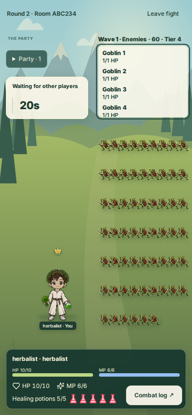
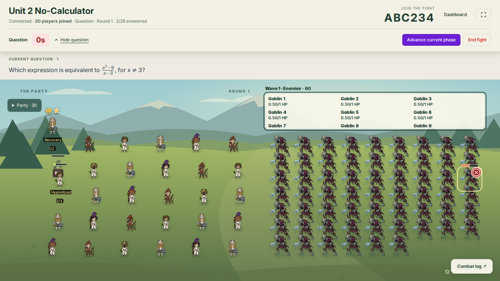

# PR #79 release — October 20, 2026 (UTC)

Status: merged and deployed; canonical acceptance blocked after two failures.

The owner authorized review, merge, the established production deployment and
canonical acceptance. Review found no blocking discrepancy with the approved
[adaptive encounter and battlefield requirements](../combat/adaptive-encounter-tier.md).
No database migration, reward-rule change or production reset is part of PR #79.

## Immutable release evidence

| Item | Evidence |
| --- | --- |
| Reviewed PR | [#79](https://github.com/Orsnoire/FightSchool/pull/79), head `be6916406e6c9990d1a01273817966545214d9e7` |
| Current-head CI | [39322031490](https://github.com/Orsnoire/FightSchool/actions/runs/39322031490): success; 325 tests, TypeScript and both builds |
| Current-head browser acceptance | [39322031491](https://github.com/Orsnoire/FightSchool/actions/runs/39322031491): battlefield rendering, browser, authoring/lobby and initial loading all pass |
| Expected-head merge / deployed commit | `989c9ec63453d06804900d0458d89664391bf849` |
| Reviewed and merged tree | Identical: `79607c7ed4b67b3ed0d6b8e0b2b586f4dba4c3ed` |
| Merged-main CI | [39437403547](https://github.com/Orsnoire/FightSchool/actions/runs/39437403547): success |
| Production deployment | [39438053539](https://github.com/Orsnoire/FightSchool/actions/runs/39438053539): success, exact merged commit; tests/builds, R2, existing additive migration gate, Worker publication and both hostname smoke checks |
| Worker | `questacademy-staging`, version `6b254de6-e7d8-46f7-9daf-bc878c8351bd` at 100% |
| Provider deployment | `8113e654-be40-42eb-936b-abecdff8fbf9`, created `2026-10-20T14:21:11.387381Z`; Wrangler reported version at 14:21:13 UTC |
| Canonical origin | `https://questacademy.bookwyrminteractive.studio` |
| Canonical acceptance | [39438588938](https://github.com/Orsnoire/FightSchool/actions/runs/39438588938), exact deployed commit; attempts 1 and 2 failed |

The established workflow is named `Deploy Cloudflare Staging`, but publishes the
production Worker serving the canonical domain. Its existing gates were retained.
Later evidence-only commits do not change the deployed runtime.

## Requirement checks

| Requirement | Review and verification |
| --- | --- |
| Readable individual enemy list | Reviewed shared teacher/student top list, topmost wave heading, wrapping names, HP/status and bounded scrolling. Current-head Chromium checks cover phone/Chromebook/4K geometry, final-entry access, host controls and student status separation. Phone student and desktop 60-goblin screenshots were visually inspected. |
| Automatic tiers | Exact average of current-job effective levels after guild caps, thresholds 2/6/10, authored minimum and maximum 4; locked at Start Fight. Deterministic tests cover thresholds, mixed levels, caps, preview/start and late-entry/recovery. Live progression probe raised a minimum-tier-1 lobby to tier 2 after earned XP. |
| Starting swarms | Base quantity multiplied by effective tier, existing attendance additions, fixed-group counts, 60/group and 120/fight caps preserved. Live 5-goblin swarm plus fixed boss produced 6/11/16/21 total enemies at tiers 1/2/3/4; preview and start snapshots agree. |
| Full HP coefficient | New fights use full reference output, existing additive attendance and 10/15/25/50 role shares, integer HP and 1 HP floor. Live tier matrix below matches the shared calculator. |
| Existing active room | Synthetic room `3X9A8W` started before deployment. After deployment and reconnect, its absent saved `encounterTier`, all six enemy IDs/counts and maximum HP were unchanged: five goblins at 1 HP, boss at 43 HP. Compatibility tests also cover late-entry rescaling and older room formats. |
| Student progression | Synthetic assigned-guild victory persisted wizard job level 4. A newly created authored-tier-1 lobby used effective level 4, selected tier 2 and started 10 goblins plus one boss. No direct XP/database edits were used. Canonical teacher/student acceptance also covers durable XP, rewards, quests, shop, history and owner isolation. |

Live HP matrix: one level-1 wizard, ten questions, one trash-role goblin swarm
with authored quantity five and a fixed boss in the next wave. The nominal pool
is the full encounter pool; this fixture uses only the trash and boss shares.

| Effective tier | Room | Total enemies | Nominal HP pool | Each goblin HP | Boss HP |
| ---: | --- | ---: | ---: | ---: | ---: |
| 1 | `8MCQCY` | 6 | 172 | 3 | 86 |
| 2 | `WAL239` | 11 | 551 | 5 | 275 |
| 3 | `W7N8PP` | 16 | 964 | 6 | 482 |
| 4 | `Y77WEJ` | 21 | 5682 | 28 | 2841 |

The live automatic-tier room was `UYJUZX`. All eight supplemental probe fights
were archived through the owning teacher API. Synthetic accounts/guild and
earned evidence remain under the existing acceptance fixture policy. An initial
progression fixture lacked a guild assignment and correctly earned zero XP;
the corrected assigned-guild fixture passed without application changes.

The [one-off probe source](2026-10-20-pr79-probe.mjs) is retained for audit. It is
manual, creates synthetic production records, and is not added to CI. Its
`before`/`resume-before` modes require the preceding runtime; this capture cannot
be repeated in full after deployment. It ran with Node 24, `--import tsx`, an
external mode-0600 `PROBE_STATE` file and the environment's outbound proxy. No
cookies, credentials or private state file are committed. Later edits to the
source only enforce explicit modes and reject state paths inside the repository.

## Failed gate investigation

Attempt 1, job `118682119165`, passed teacher/student combat, R2, 30-player join
and room isolation, host controls, moderation and socket revocation. At
14:26:40 UTC the 30-answer acknowledgement burst timed out. The subsequent
completion check also timed out on those clients; it is not passing evidence.

The last reported client state was round 1's question. Read-only Cloudflare
telemetry for synthetic room `PQHCR8` showed sampled command/checkpoint/publish
events with successful outcomes, maximum observed queue 2824 ms and zero
reported broadcast failures. The surrounding window also contained canceled
WebSocket fetch invocations. These observations do not establish a root cause
or prove every connection remained healthy. The transport/command code and
operational fixture are unchanged from the preceding accepted release.

Attempt 2, job `118687957398`, reproduced the connection timeout at 14:36:58 UTC;
the dependent completion check failed at 14:37:43 UTC. All other checks passed.
The exact same acceptance job was rerun against the same deployed SHA and
canonical origin. No timeout, threshold, assertion, runtime, Worker setting or
test scope was weakened. Both failures remain part of the release record. A temporary client diagnostic
run adds socket state, close code/reason and timing without altering the gates.
Release acceptance remains blocked pending diagnosis and correction.

## Data and C12 boundary

Only normal APIs with newly created synthetic users were used for supplemental
acceptance. Existing student data, progression, permissions and rewards were
not reset or rewritten. Standard deployment migrations ran their existing
additive gate; this PR introduces none. No recovery or rollback drill was run.

C12 remains separate in draft [PR #75](https://github.com/Orsnoire/FightSchool/pull/75),
head `9bd0266114c56c15340eae68a055b5767f206043`. Its isolated rehearsal Worker
`questacademy-rehearsal-aacc47d9` still serves version
`cc85f8d6-acbe-411e-9320-bbea1188e66d` at 100%, deployment
`ca988dca-1bdf-4bc3-b45d-69affc75084b` from October 19 at 04:49:54 UTC.
No C12 branch, rehearsal database, bucket, Worker settings or safeguards were
modified by this release.

## Visual evidence and limits

The following are reviewed current-head Chromium fixtures from artifact
`12220887114` in run `39322031491`, not screenshots of a real classroom.
The canonical deployment's lazy-loaded `CombatOverlay-pQmYE67V.css` was also
checked for the new enemy-list rules. No separate signed-in manual production
browser session was performed. Live behavior was exercised by authenticated
HTTP/WebSocket acceptance.

Functional acceptance does not close C08 physical-device performance limits or
C12 isolation, recovery and rollback work. Exact higher automatic thresholds
and attendance caps have deterministic coverage; live probes cover all four
authored minima and the earned-progression automatic tier-2 transition.
