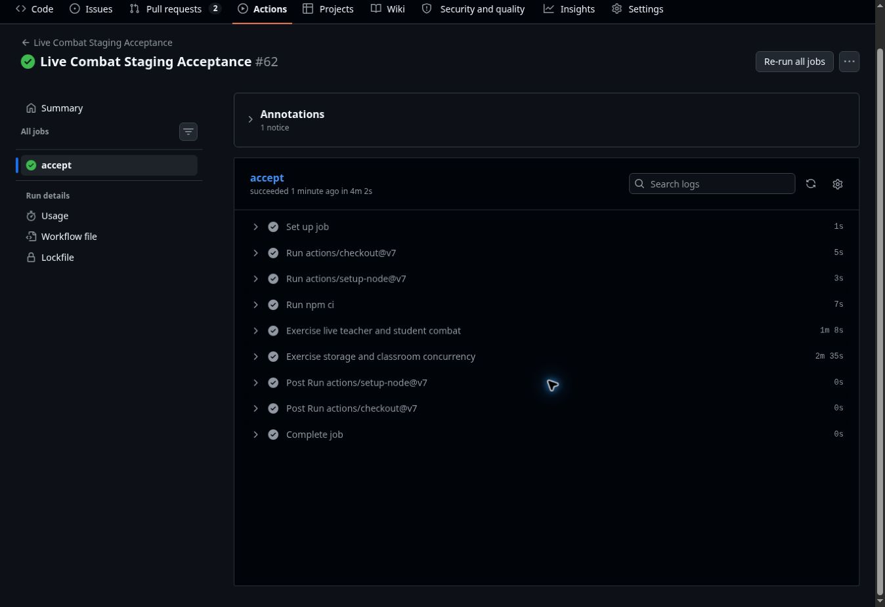

# Canonical live combat recheck — October 21, 2026 (UTC)

Status: **PASSED on the first attempt**. This is a fresh acceptance check of the
existing PR #79 production release; no application change or deployment was made.

## Run and release identity

| Item | Evidence |
| --- | --- |
| Canonical run | [39632143499](https://github.com/Orsnoire/FightSchool/actions/runs/39632143499), attempt 1, job `119332936362`: success |
| Test source | `244e076aad345e61d80f09438cd7e6995d3c617c`, current `main` when dispatched |
| Origin | `https://questacademy.bookwyrminteractive.studio` |
| Recorded deployed runtime | `989c9ec63453d06804900d0458d89664391bf849`, [deployment 39438053539](https://github.com/Orsnoire/FightSchool/actions/runs/39438053539) |
| Last provider-verified Worker | `questacademy-staging`, version `6b254de6-e7d8-46f7-9daf-bc878c8351bd`, 100% on October 20 |
| Original reviewed-head checks | All five remain successful on `be6916406e6c9990d1a01273817966545214d9e7`: CI verify, battlefield-rendering, browser, authoring-lobby and initial-loading |

The complete Git comparison from deployed runtime to this test source contains
only documentation/evidence and the already-merged operational test diagnostics
from PR #80. Application code, dependencies, migrations and Worker configuration
are unchanged. GitHub's workflow history contains no newer deployment.

**Provider verification limitation:** Cloudflare's connector returned internal
errors for deployment lookup, identity and endpoint discovery. The Worker version
above is the last verified version, not a fresh provider observation. No fallback
provider mutation was attempted. Both the canonical domain and workers.dev domain
returned HTTP 200 with `ok` from `/api/health/live` and `ready` from
`/api/health/ready` during this recheck.

## Acceptance results

- Teacher/student combat passed: damage, atomic action/ready, Fireball MP,
  wrong answers, enemy AI, cycling, reconnect deadlines, stale/retried commands,
  completion-driven resolution, empty victory and persisted palettes.
- Student progression and ownership passed: durable XP, guilds, quests, shop,
  reward claims, solo hosting, retained history, teacher-scoped question reports
  and owner isolation.
- All eight operational checks passed: R2 upload/integrity/authorization and
  byte ranges; 30-player joins and room isolation; simultaneous answers and
  reconnect; exactly-once classroom results; dashboard/end/launch isolation;
  late entry/moderation/fractional rewards; and logout socket revocation.
- The 30-answer burst measured p50 **2115 ms**, p95 **3976 ms**, maximum
  **4128 ms**, below the unchanged **15000 ms** gate. This is one functional
  sample, not a repeated performance benchmark.
- No assertion, timeout, classroom size or threshold was weakened. No failed
  gate or rerun occurred in this recheck. The two October 20 connection timeouts
  retain their previously documented, unconfirmed cause.

The [original release record](2026-10-20-pr79.md) retains the requirement-specific
browser evidence, four-tier swarm/HP matrix, pre-deployment room compatibility
probe and earned-progression automatic-tier probe. Those supplemental probes and
manual visual inspection were not repeated today; this run refreshed canonical
authenticated HTTP/WebSocket acceptance against the unchanged application.

## Data and isolated work

Only the existing acceptance workflow's newly created synthetic users, guilds,
fights and object were exercised. Its ordinary API archive steps completed.
Existing student records and progression were not reset or rewritten. No
migration, production deployment, recovery or rollback drill was performed.

C12 remains separate in draft PR #75 at
`9bd0266114c56c15340eae68a055b5767f206043`. No C12 branch, rehearsal Worker,
database, bucket or safeguards were modified. Campaign PR #81 remains separate.
This acceptance result makes no new claim about C12's provider state.

