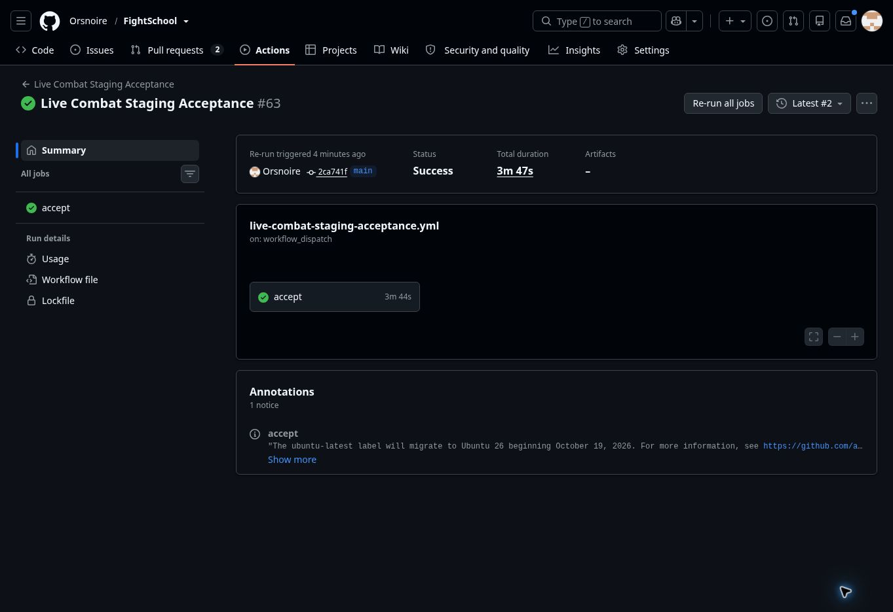

# Math rendering release — October 21, 2026

## Release identity

- PR #83 merged with an expected-head check at `2ca741ff28a81d75c75de59c51d784415c7e418a`. The merge tree is identical to reviewed head `684b4c8d3174e07bbb92b24b6be2b41b37da7e72`.
- Exact-head [CI 39637847126](https://github.com/Orsnoire/FightSchool/actions/runs/39637847126) and all four [Chromium jobs 39637847160](https://github.com/Orsnoire/FightSchool/actions/runs/39637847160) pass. CI verifies 334 tests, TypeScript and both production builds. [Merged-main CI 39695413818](https://github.com/Orsnoire/FightSchool/actions/runs/39695413818) also passes.
- [Production deployment 39695583585](https://github.com/Orsnoire/FightSchool/actions/runs/39695583585) passes from that exact merge: checks/tests/builds, existing additive migration gate, R2 and both hostname smoke checks.
- Fresh Cloudflare provider read confirms Worker `questacademy-staging`, immutable version `3e87099c-a7b6-4c18-b023-75262acd44ac`, at 100%. Deployment `d32cfbb5-f061-4d1b-879e-2fe4599436bb` was created at 23:48:21 UTC.
- Fresh domain lookup confirms `questacademy.bookwyrminteractive.studio` routes to `questacademy-staging` in Cloudflare's production environment. The workflow's historical “Staging” name is not an isolated environment.
- An automatic approval review initially rejected the deployment click because of that name. Read-only provider mapping resolved the target ambiguity; the same established workflow was then permitted and completed. No alternative deployment path or security change was used.

## Math-specific live verification

The original Library CSVs were materialized unchanged and parsed with the exact merged importer.

| Quiz | Questions | Equations | Superscripts | Subscript/combined-script nodes | Fraction nodes |
| --- | ---: | ---: | ---: | ---: | ---: |
| Differentiation | 24 | 144 | 112 | 1 | 42 |
| Integration | 24 | 120 | 64 | 0 | 47 |

All **48 questions / 264 equations** pass against the renderer downloaded from the canonical site:
`/assets/RichContentRenderer-BrZ6rZ5U.js`, SHA-256
`df55e624b0b44487058986109853c68d771c917e9f31b8c9d7cf8c2c2d4321ee`.
The entry page referenced `/assets/index-C3d3OJ5_.js`.

The downloaded renderer was executed in JSDOM. Only its React import was removed and its existing renderer function exported; no rendering logic was rewritten. Every expected equation produced KaTeX/MathML without errors. Raw `x^2`, `x_1`, fractions, inline/display delimiters and ordinary prose/currency/identifier preservation also pass.

Using canonical authenticated HTTP and WebSocket endpoints, one synthetic teacher and two synthetic students verified:

- Both complete quizzes were created, read, updated and read again; all 24 question sources, options, correct-answer strings and timers in each quiz remained identical.
- For the first question of each quiz, the original Answer1 was graded **correct** and an original distractor **incorrect**, with option shuffling enabled. Feedback retained the exact original key and rendered successfully.
- Both synthetic sessions were ended and both test fights archived through their ordinary owner-scoped API. The fixture identities and timestamps are in the adjacent JSON evidence. No real student or owner question bank was edited.

CSV SHA-256:
- Differentiation: `83e99835a7869bddc00d16a7a68c70b951023621f458f71b3fa380c19f4222ef`.
- Integration: `7b01b6a17386d6c3c0ebd4933be83300e690108d59465e3f9089a69cd5775b7d`.

This is deployed-bundle DOM verification plus live persistence/grading verification, complemented by exact-runtime desktop/phone browser import/edit/save/reload tests. It is not a fresh authenticated visual inspection of the owner's saved quizzes; the browser was at sign-in. The integration quiz contains no subscript expression, so its zero count is expected; the differentiation file and raw-notation probe verify subscripts.

## Canonical combat acceptance

[Canonical acceptance 39695893872, attempt 2](https://github.com/Orsnoire/FightSchool/actions/runs/39695893872/attempts/2) **passed** at the exact deployed commit against the canonical origin.

Teacher/student combat, correct/incorrect answers, Fireball MP, enemy AI, question cycling, reconnect deadlines, stale/retried commands, progression, quests/shop/history, reporting and owner isolation pass. All eight operational checks pass: R2 integrity/authorization/ranges, 30 participants and concurrent rooms, simultaneous answers/reconnect, exactly-once completion, host controls, moderation/fractional rewards and logout revocation.

The 30-answer burst measured p50 **1857 ms**, p95 **3564 ms**, maximum **3664 ms**, below the unchanged 15000 ms threshold. This is a functional sample, not a repeated benchmark or C12 performance signoff.

Attempt 1 failed at `live-combat-acceptance.mjs:294`, waiting for the first-round abilities phase after the action command. It had verified incorrect-answer feedback. Root cause remains unconfirmed. The unchanged workflow was rerun once and passed; no assertion, timeout, room size or threshold was weakened, and no application change was made between attempts.

## Data and other open PRs

The repair changes only display logic, plus regression tests and documentation. It adds no schema migration, stored-question rewrite, reward-rule change or data reset. Production's existing migration gate passed; individual database ledger rows were not independently re-read.

Only newly created synthetic acceptance records were exercised. Existing student progression, content and results were not reset or modified. The failed first workflow attempt may retain its own synthetic records under the pre-existing fixture behavior; no broad cleanup was attempted.

- Campaign PR #81 remains open on `feature/campaign-pilot`, head `d7c4a835f4ccc7169452c492d5b7262d9fb6ad0e`. Its fixed-target preview release run 39671999772 is successful and its latest runtime is already deployed to its separate preview. It has merge conflicts and still records owner boss-victory acceptance as pending. Its migrations and production integration were not combined with this math release.
- C12 PR #75 remains draft/open at `9bd0266114c56c15340eae68a055b5767f206043`. Exact-head CI 39202689169, Chromium 39202689164 and Avatar Workshop 39202689153 are successful, correcting the stale uncertainty in its description. Merge conflicts and operational exit gates remain: credential/production mapping inventory, repeated representative measurements, recovery and rollback drills, Chromebook observation and monitoring ownership/window. No C12 resource or gate was changed or waived.

The owner's broad request to merge/deploy open PRs was applied to release-ready #83. The two incomplete releases above were reviewed and kept separate as requested; they were not falsely marked ready or merged.
