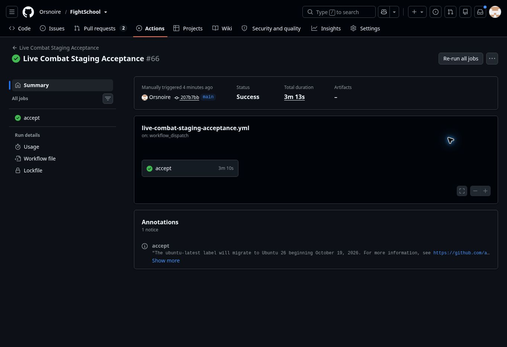

# Alternate Advancement release — October 26, 2026

## Release identity and review

The owner authorized review, merge and production deployment. [PR #86](https://github.com/Orsnoire/FightSchool/pull/86) merged with an expected-head check at `207b7bbdf9c0e8a1b0d6c8b169a2d452ead7ac6f`. Its tree `fe41563ecf019cb17ceceb8e47112a353e5fd9ee` is identical to reviewed head `56c6a1f7d741215fceef73629f93e151a0f0720d`.

Focused review covered authenticated ownership and strict server-priced requests, purchase/award row locking and idempotent receipts, migration preservation, closed free-appearance bypasses, tier-capped loadout/stat parity, combat randomness and historical-room recovery. No blocking issue was found. PR discussion had no unresolved review comments at release.

- [Exact-head CI 40369054272](https://github.com/Orsnoire/FightSchool/actions/runs/40369054272): **364 tests**, TypeScript and both production builds pass.
- All four [Chromium jobs 40369053740](https://github.com/Orsnoire/FightSchool/actions/runs/40369053740) pass. Desktop 1366×768 and phone 390×844 screenshots were inspected. AA checks cover rank/filter/keyboard access, failed-save receipt reuse, paid customization/cancel, fifth-slot add/remove/reload, all-five persistence across editors, tier suppression and actual Hex/Fortify commands from slots 3/5 through the real engine.
- [Merged-main CI 40370558997](https://github.com/Orsnoire/FightSchool/actions/runs/40370558997) passes on the exact merged runtime.
- [Deployment 40370834834](https://github.com/Orsnoire/FightSchool/actions/runs/40370834834) passes on that commit, including tests/builds, R2, additive migration **0018**, Worker publication and both canonical/workers.dev smoke checks.
- Fresh Cloudflare evidence confirms the canonical domain routes to the historical `questacademy-staging` Worker. Version `edc96b23-6e74-4916-9330-ad5cbc3359a1` serves 100%; deployment `3e94f419-b21a-4148-af73-99e050fd0091` was created at 17:42:27 UTC (11:42:27 MDT). Wrangler reports the same version.

## Released behavior

Students can spend preserved overflow XP on tier-limited AA ranks through the Advancement screen. Every 60 overflow XP earns one AA; cumulative earned XP and fractional carry remain. Primary-stat amounts/prices and existing multiclass growth are retained, without a total active-AA budget. The shared catalog drives rank effects, prices, previews and purchases. Initial appearance creation and ordinary job changes remain free; completed combined recustomization costs 5 AA.

Two existing cross-class slots plus three AA slots share the same editor and combat admission rules. Tier limits suppress ranks and abilities without erasing purchased ranks or saved assignments; effects freeze per encounter. All 23 active cross-class unlocks execute in deterministic coverage. Soul Echo is an equipped passive for other classes in new rooms, never a selectable no-op. Fortify wording reflects its actual non-stacking double-VIT effect.

Wrong or unanswered questions clear every class's combo points without AA. Combo Preservation retains up to active rank 1/2/3 of points already held. Wrong-answer damage and retaliation cannot refill them; normal Monk monster-hit gains remain. Explicit coverage spans 1,536 combinations, and approved mixed-answer replay outputs have a separate dated fixture without rewriting the original C10 artifact.

## Canonical live acceptance and limits

[Acceptance 40371373272](https://github.com/Orsnoire/FightSchool/actions/runs/40371373272), attempt 1, passed against `https://questacademy.bookwyrminteractive.studio` on the exact merged runtime. Teacher/student combat, answer/action/playback transitions, MP and enemy AI, reconnect deadlines, durable progression, guilds/quests/shop/rewards, solo hosting, history and owner isolation passed.

All eight operational checks passed: R2 integrity/ranges/authorization; 30 participants and concurrent rooms; simultaneous answers/reconnect; exactly-once completion; host discovery/end/launch controls; late entry/moderated rejoin/fractional rewards; and open-socket logout revocation. The answer sample measured p50 **1,458 ms**, p95 **2,767 ms**, maximum **2,867 ms**, below the unchanged 15,000 ms functional threshold. This is one functional sample, not a repeated performance benchmark or C12 signoff.

The live fixture verifies general combat/progression and deployed schema compatibility. AA purchase concurrency, tier behavior and complete UI interactions are covered by isolated migrated-database and browser tests; no live student AA balance was edited to manufacture acceptance. Individual production wallet/ledger rows were not independently audited. Classroom pacing and physical-device observation remain unmeasured. [Balance analysis](../reviews/2026-10-26-alternate-advancement.md).

Release boundary: **COMPLETE / MERGED / DEPLOYED / ACCEPTED**. Migration 0018 is additive; no student-data reset occurred. A rollback must preserve AA wallet/receipt data and retain the paid appearance guards in a compatibility runtime. Campaign #81 still needs its stricter power-context adapter and migration-number reconciliation; C12 #75 remains separate.

