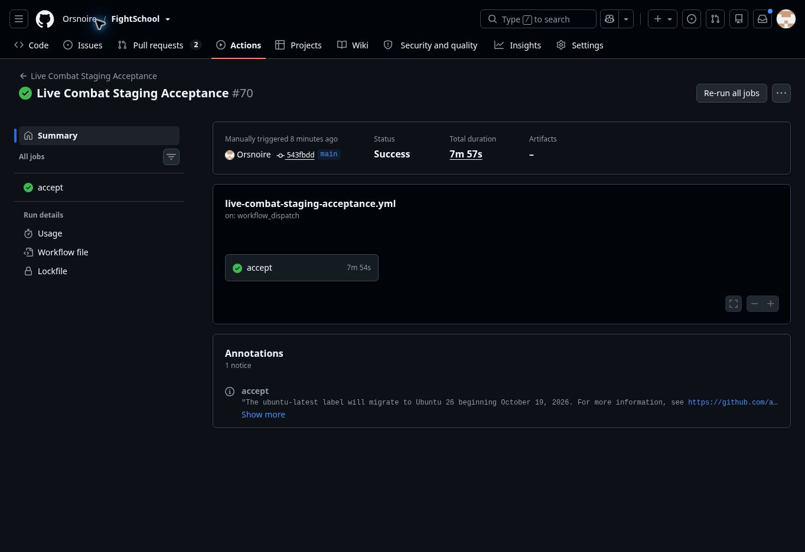

# PR #90 — campaign art and question-bank release

Merged runtime: `d44995a109e8ca5549e29ba63c616b68d84e2ac3`. Its tree matches reviewed head `7688151` exactly. Production serves Worker `3c55150b-5deb-40bd-a8d2-feeabe9e5e43` at 100%; canonical, short and workers.dev hostnames pass readiness.

## Verification

408 application tests, 11 original deployment tests, TypeScript, both builds and all four Chromium jobs pass on the reviewed head. [Merged-main CI](https://github.com/Orsnoire/FightSchool/actions/runs/40767932864) passes. Release-tooling follow-up adds a twelfth deployment test plus old-ledger/unknown-stage rejection cases; all pass in [CI 40770335411](https://github.com/Orsnoire/FightSchool/actions/runs/40770335411), alongside all 408 app tests, TypeScript and both builds. All four [browser jobs 40770335219](https://github.com/Orsnoire/FightSchool/actions/runs/40770335219) pass. PR #91 merged at `a5e234233eb706cbd3e6e6c9b8193ef7d51b746f` with the tested tree unchanged. [Read-only production preflight 40771213932](https://github.com/Orsnoire/FightSchool/actions/runs/40771213932) passes. [Canonical live acceptance](https://github.com/Orsnoire/FightSchool/actions/runs/40769862238) passes combat/progression and all eight operational checks: storage, 30 players/answers, reconnect, exactly-once results, moderation and revocation. A local acceptance attempt failed to open WebSockets because of the runner's DNS restriction; no local acceptance pass is claimed.

## Migration and preservation

An isolated production child rehearsed the exact forward 0025 routine replacement, with guarded catalog/ledger and all-public-table digest comparisons. Reexecution was a no-op. After protected writer pause and complete room verification, a separate native recovery copy captured production. The live transaction preserved every existing public-table row, checked the exact original 25-row ledger prefix and reached the canonical 26-row ledger and question-bank schema fingerprint. Every saved room then matched its pre-migration checkpoint.

[Protected maintenance 40768311269](https://github.com/Orsnoire/FightSchool/actions/runs/40768311269) built/tested/deployed the pinned merge but stopped on room-probe HTTP 401 during propagation. The database was unchanged at that stop. A subsequent full read-only verification passed without changing the runtime, fixtures or checks. The first resume settings PATCH was atomically rejected because it omitted the existing durable-object export. Retrying with the unchanged CombatSession SQLite export succeeded; every other binding and the namespace identity were verified unchanged. Completed maintenance windows remain and the temporary release probe is removed.

Private recovery identities, row/room fingerprints and probe values remain outside GitHub. No paid-plan change, reset or preview-save import occurred. The release requests return to read-only preflight with the explicit question-bank stage. Historical stages and upgraders remain bounded; do not replay the 20-to-25 upgrader or preview bridge on current production.

## Remaining beta handoff

Beta access is still closed. The owner must select a dedicated production guild before authorized/denied access and authenticated guardian/stamina acceptance. The separate preview stays on its existing version and 29-row history. C12/PR #75 remains separate. [Review screens](../reviews/2026-10-28-campaign-visual-pass.md) show the shipped art using synthetic fixtures; final assembled-art feedback remains welcome.

All five live WebP files match the tested build byte-for-byte. One functional classroom sample measured answer acknowledgement p50/p95/max of 2478/5357/5407 ms; this is not a C12 performance acceptance claim.

