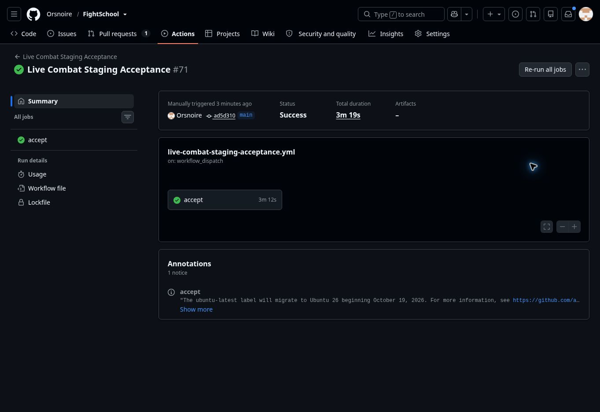

# Campaign terrain tile correction — October 29, 2026

[PR #93](https://github.com/Orsnoire/FightSchool/pull/93) is merged at `236ea0f37bba5f798ff2e48ced56d938017c7a2c`, with exactly the tested `95fbba2` tree. Each terrain material fills one 48×48 map cell and repeats at every coordinate; it no longer stretches across the map. The existing 47 border masks, icons, equipped avatar, camera, traversal and saved layouts are unchanged. The owner's correction is recorded in the art direction and asset manifest.

[CI 40884245454](https://github.com/Orsnoire/FightSchool/actions/runs/40884245454) and all four [Chromium jobs 40884245486](https://github.com/Orsnoire/FightSchool/actions/runs/40884245486) pass. The new browser check verifies every terrain cell in both zones, both camera modes and desktop/phone viewports. Exact-head screenshots were downloaded and the desktop overworld and phone cave/overview inspected. Local TypeScript, client/Worker builds and three campaign-art tests pass; local Chromium installation was unavailable, so browser evidence comes from CI. Merged-main CI 40885069405 also passes.

[Protected deployment 40885240111](https://github.com/Orsnoire/FightSchool/actions/runs/40885240111) passes. Production serves the pinned merge at 100%, Worker `beae082d-7dc0-415a-8648-3990a0673928`. Complete paused verification confirms the current canonical 26-row ledger and every saved combat room; a second complete verification confirms those rooms remained unchanged during the pause. No database migration or reset occurred. Both domains are ready, the release probe is removed and completed maintenance windows remain. All other bindings, secrets and storage identities are unchanged, including the AP Precalc 2027 and AP Calculus beta allowlist. Live campaign JavaScript and CSS match the tested build byte-for-byte.

Canonical live acceptance [40886432975](https://github.com/Orsnoire/FightSchool/actions/runs/40886432975): PASSED. Live teacher/student combat and all eight operational checks pass, including storage, 30-player concurrency, reconnect, exactly-once rewards, moderation and revocation. Production release requests return to read-only preflight and the provider pin follows the resumed version. Preview and C12 remain unchanged. Private operational fingerprints remain outside GitHub.

Beta access is enabled for the two selected guilds. Each still needs a teacher-created campaign under **Campaigns · Beta**; each player then chooses an assigned fight. This release does not claim authenticated guardian/stamina owner playtest acceptance or C12 performance signoff.

