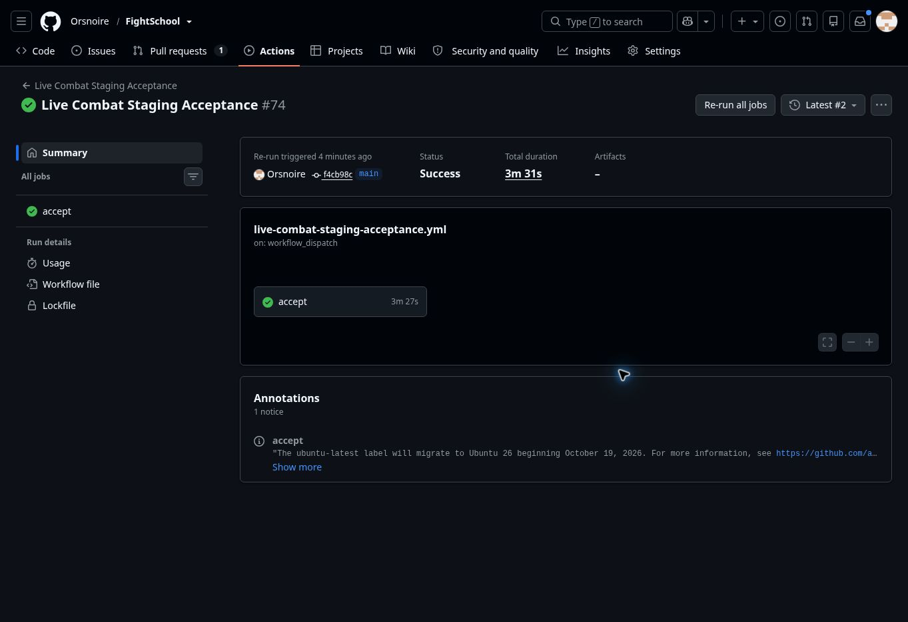

# MATH-01 exact grading foundation — November 3, 2026

Status: **MERGED / DEPLOYED / OPERATIONALLY ACCEPTED**.
The owner requested merge and deployment after reviewing the bounded implementation.
[PR #96](https://github.com/Orsnoire/FightSchool/pull/96) is merged at
`b408f9be70c8458cc8012b327cb8058210276bbf`. Its tree exactly matches the reviewed
head `6f2c8ef138c94a00e1e50a21895aa07bb29ab850`.

The teacher-only `POST /api/fights/math/grade-preview` now grades exact numerical
and fractional answers, with optional numerical domain and literal-form constraints.
It writes no questions, attempts, results or rewards. Fixed-question combat still
uses its existing text grading. No teacher UI, generated session, PDF recognition,
symbolic equivalence or curriculum family is introduced.
[Contract, bounds and decisions](../reviews/2026-11-03-math-01-exact-grading.md).

## Source and verification

- Implementation `91fd2a9`: all **433 application tests**, including 14 focused
  grading tests and real Worker/PGlite boundary coverage; **13 deployment
  safeguards**, TypeScript and both client/Worker builds pass. No dependency changes.
- Final-head [CI 41666475228](https://github.com/Orsnoire/FightSchool/actions/runs/41666475228)
  and all four [browser jobs 41666475230](https://github.com/Orsnoire/FightSchool/actions/runs/41666475230) pass.
- [Merged-main CI 41668040437](https://github.com/Orsnoire/FightSchool/actions/runs/41668040437)
  and [production preflight 41668209329](https://github.com/Orsnoire/FightSchool/actions/runs/41668209329) pass.
- [Protected release 41668467912](https://github.com/Orsnoire/FightSchool/actions/runs/41668467912)
  rebuilt and tested the pinned merge, then uploaded it. Final verification stopped;
  the maintenance gate remained closed. A subsequent unchanged, read-only
  [verification 41669392372](https://github.com/Orsnoire/FightSchool/actions/runs/41669392372)
  passed, independently checking database identity, canonical ledger and every room.

## Production state

| Item | Verified value |
| --- | --- |
| Canonical origin | `https://questacademy.bookwyrminteractive.studio` |
| Secondary origin | `https://questacademy-staging.coxsonator.workers.dev` |
| Source | `b408f9be70c8458cc8012b327cb8058210276bbf` |
| Serving Worker version | `321d7d83-d9cf-4754-b13a-f9e3a2f13871`, 100% |
| Release window | `production-math-01-20261103`, completed |
| Migration ledger | Canonical question-bank stage, 26 entries, unchanged |
| Readiness / release probe | HTTP 200 on both origins / temporary probe removed (404) |

Two complete supplemental scans confirmed identical sorted saved-room digests
during the pause. Their bounded read retries recovered two HTTP 503 responses;
no mismatched source, database, ledger or room receipt was accepted. The initial
workflow failure and intermittent probe responses have no confirmed root cause.
The supplemental comparison initially compared concurrent result insertion order;
it was corrected to use the release helper's existing sorted room digest, then both
full scans were repeated successfully. Repository release assertions were unchanged.

The same runtime was resumed through settings updates. Completed maintenance
windows remain for sleeping-room clock recovery. All ordinary bindings, secrets,
beta allowlist and storage identities are unchanged. Provider export reconciliation
created, deleted, transferred or renamed no namespace. No migration, reset or edit
to existing student data occurred. Preview and C12 remain separate.

## Live evidence

The canonical math-preview smoke passed nine cases: equivalent fraction, exact
decimal, unequal value, required form, excluded numerical value, unsupported
symbolic input, malformed expression, division by zero and invalid contract version.
Unauthenticated access returned 401, an untrusted origin returned 403, and graded
responses were non-cacheable. This smoke created only a unique teacher acceptance
fixture and logged it out; no student, fight or result was changed by that probe.

[Canonical acceptance 41670592264](https://github.com/Orsnoire/FightSchool/actions/runs/41670592264)
attempt 1 passed teacher/student combat and seven of eight operational checks.
A QA participant's WebSocket closed with code 1006 before the 30-player completion
check could submit its ready command; exactly-once result persistence was therefore
not established by that attempt. Its cause is unconfirmed. **Attempt 2 passed**
teacher/student combat and **all eight operational checks**, including 30-player
exactly-once results, reconnect, room isolation, storage, moderation and revocation.
The full suite used the same source, runtime, canonical origin, fixtures and deadlines.
The existing acceptance suite uses dedicated QA accounts and rooms. The passing
answer burst recorded p50 1,761 ms, p95 3,319 ms and max 3,420 ms against the existing
15-second limit; this is one automated fixture, not C12 classroom performance signoff.

The release request has returned to read-only preflight and its provider-version
pin follows the final serving version. The resulting protected
[preflight 41670826530](https://github.com/Orsnoire/FightSchool/actions/runs/41670826530)
passed, as did [CI 41670827053](https://github.com/Orsnoire/FightSchool/actions/runs/41670827053);
all 13 deployment safeguards also pass locally with the updated release metadata.
Remaining MATH-01 template/instance contracts,
broader symbolic work and MATH-02–06 are deferred. Live mathematics grading still
requires explicit persistence, answer-secrecy and indeterminate/completion policies.

Earlier browser run 41665998999 timed out closing the Fighter's Claymore dialog;
the final-head suite passed with identical code and deadlines. That earlier failure
remains recorded without a confirmed root cause.

