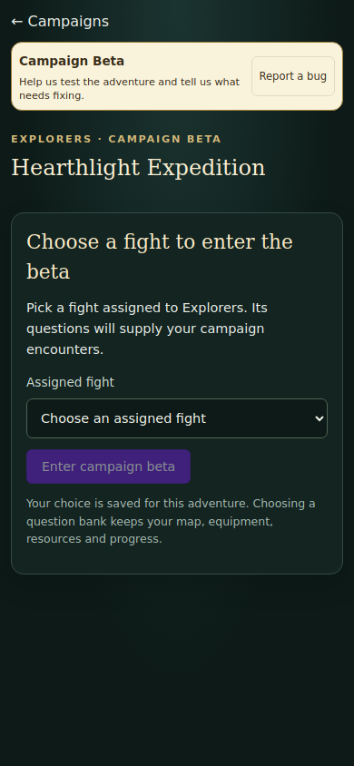
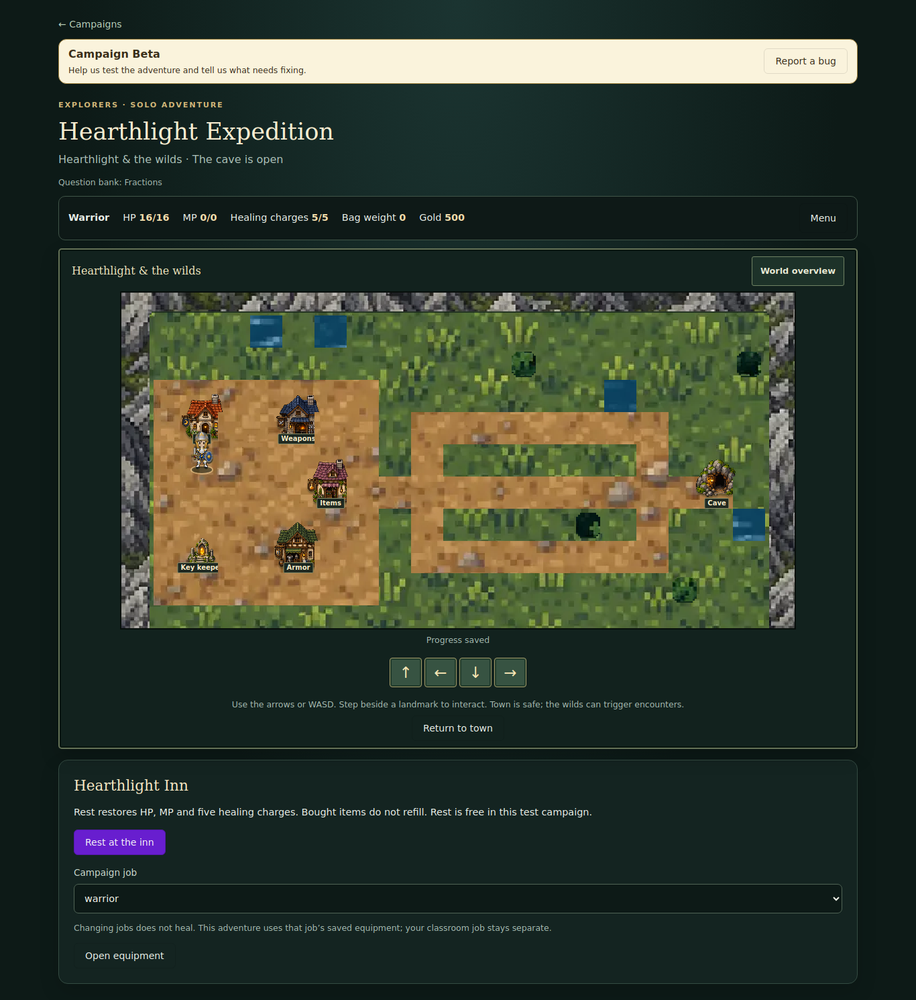
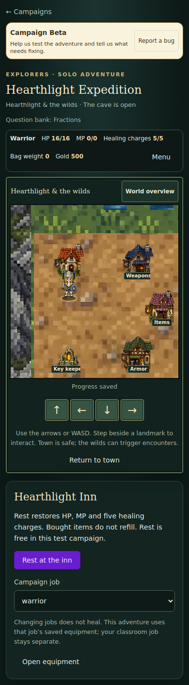
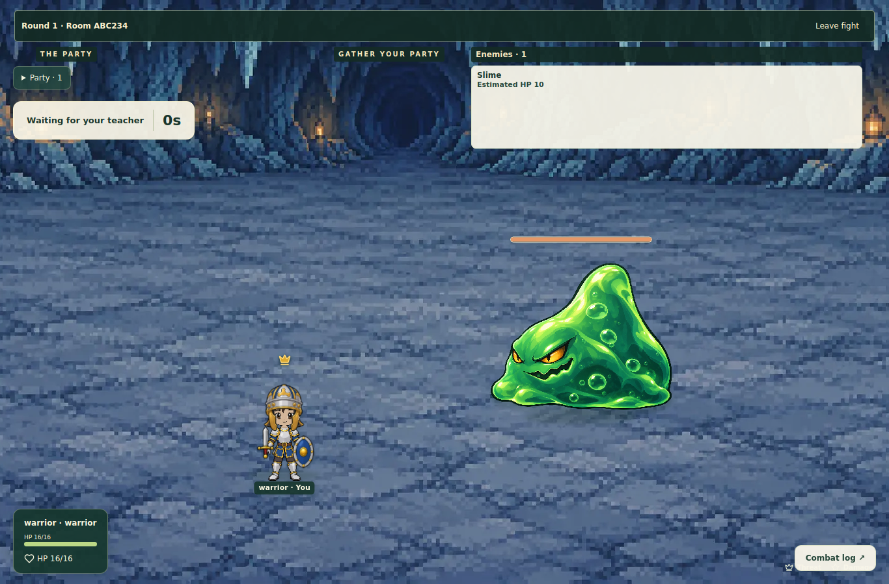
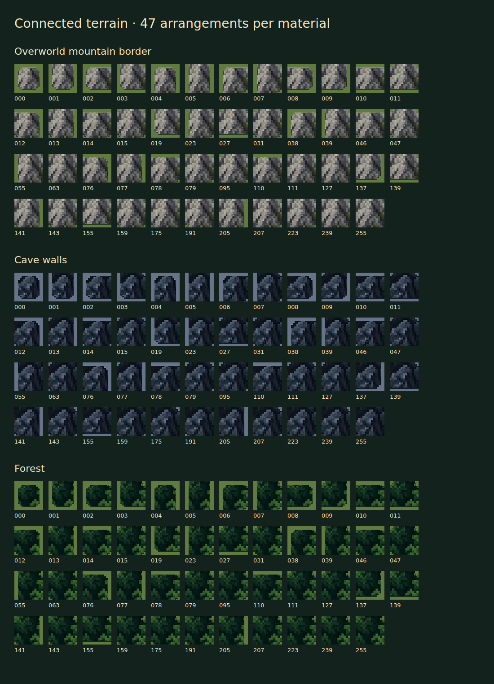

> **Released October 28:** PR #90 is merged, production migration 0025 and deployment are complete, and canonical live acceptance passes. Beta remains closed. [Release evidence](../releases/2026-10-28-pr90.md) controls current status; earlier checkpoints below are historical.

# Campaign graphics and question-bank entry — review checkpoint

Implemented on `feature/campaign-visual-pass`, [PR #90](https://github.com/Orsnoire/FightSchool/pull/90). The exact equipped battle avatar now appears on the map at a smaller size. Original landmarks, forest materials, all 47 mountain/cave-wall edge arrangements, a follow camera/overview and matching meadow/cave battle scenes replace the placeholders. Terrain samples a common world origin; block boundaries do not introduce texture seams. Adventure supplies/equipment/quests open from Menu.

Each student explicitly chooses a fight assigned to the campaign's guild before entry. The chosen bank is saved per player, answers remain server-only, and new encounters freeze its questions and identity. Assignment, archive/nonempty status and guild ownership are enforced both by the application and under the atomic commit locks. Existing position/resources/equipment/unlocks and old active rooms are preserved; active encounters can finish if their bank is later removed. Classrooms and legacy snapshots retain their original field shape.

**Verified:** 408 application tests, 11 deployment tests, TypeScript and both builds pass. CI [40764049194](https://github.com/Orsnoire/FightSchool/actions/runs/40764049194) and all four browser jobs [40764049323](https://github.com/Orsnoire/FightSchool/actions/runs/40764049323) pass at `861aba1`. The final terrain alignment/clipping follow-up passes local desktop/phone campaign and art browser tests, TypeScript and builds; the PR records its final exact-head CI. Local screenshots use Chromium 134; CI uses pinned Chromium 151. These are synthetic fixtures, not proof of an authenticated live owner victory.

**Release state:** ready for review, unmerged and undeployed. Forward migration 0025 is authored/tested but has not run on a provider. No beta guild is enabled and no saved playtest has been reset. The first workshop covers the existing overworld and normal cave. Road/water transition art and other biomes remain later work. [Asset contract and full prompts](../campaign-art-v1.md).

## Review images

### Guild-assigned entry choice

### Overworld, desktop

### Overworld, phone

### Cave battle

### Complete border vocabulary

## Earlier checkpoints

# Campaign visual pass — October 28, 2026

Owner requested map and battle-screen art updates before beta access. `/docs` is the art/design reference; use `CAMPAIGN_ART_DIRECTION.md`, `CAMPAIGN_DEVELOPMENT_ROADMAP.md`, `avatar-art-direction.md` and the source-of-truth hierarchy. Current baseline is main `63d61c58ad753ef09c66e464f400b591a873e689`; PRs #81/#88/#89 are merged and operationally accepted. Only C12 #75 remains open; it is separate.

Registered branch: `feature/campaign-visual-pass`. Scope: render the exact equipped battle avatar at map scale; replace the colored-button/letter placeholder map with continuous terrain and recognizable landmarks; provide coordinated original overworld and normal-cave battle artwork. Start with the existing playable region and cave, consistent with the documented one-theme workshop. Preserve existing layout coordinates, collision/access rules, movement/save behavior, avatar identity/palettes/loadouts and all progress. No regeneration, migration, beta enablement, new enemy roster or animation rig changes.

State: CLAIMED, before implementation. Next: publish draft PR, create original artwork with provenance, implement map presentation and scene selection, then verify desktop/phone screenshots and existing functional tests. Keep beta closed for visual review. Record implemented, verified, merged and deployed states separately.

## First implementation checkpoint (incomplete)

Owner approved the landmark icons and added forest terrain plus complete mountain/cave-wall border combinations. Shared equipped avatar, original material/landmark atlases, grassland/cave scenes, 47 adjacency cases, camera/overview and on-demand menu are implemented. Existing interior blocked mountain cells display forest; mountains frame the overworld without rewriting layouts/collision. The optional environment enum is fixed by the server at encounter creation. Old rooms fall back to grassland.

TypeScript passes. Browser, deterministic border and functional regression verification remain pending; no visual acceptance, merge, deployment or beta access is claimed. Next: verify fixtures and inspect desktop/phone renderings and all border combinations. [Asset contract and provenance](../campaign-art-v1.md).

## Required guild-assigned question bank

Owner added this requirement during the visual pass: before entering the beta, each player explicitly selects a fight assigned to the campaign's guild. Its questions supply that player's campaign encounters. The options endpoint returns only IDs, titles and counts; arbitrary, unassigned, other-guild, archived or empty fights are rejected. Selection survives reload/reset and does not reset maps, position, equipment, HP/MP, inventory or unlocks. Removing an assignment blocks further exploration and offers reselection; an already-active encounter can finish from its frozen snapshot. Changing banks cannot interrupt that encounter.

`questionBankFightId` is an optional field in existing progress JSON, and the public view provides availability metadata. Forward migration `0025_campaign_question_bank` rechecks the bank under fight/assignment row locks in the existing atomic commit function and writes the selected fight ID to the live session. No new table, data backfill or old ledger rewrite. The reviewed 20→25 production upgrader and legacy bridge remain bounded at 0024; ordinary migration then reaches 26 canonical / 30 bridged-preview rows. Live release still requires isolated rehearsal and preservation checks.

Local desktop/phone campaign tests (including explicit entry choice and empty options), battle-scene/legacy-fallback rendering and all 47 border arrangements pass with Chromium 134. Final CI uses pinned Chromium 151. Three deterministic art tests pass; full-suite verification is in progress after fixing fixture asset loaders and preserving absent presentation fields in old/classroom snapshots. No deployment, migration or beta enrollment has occurred.
